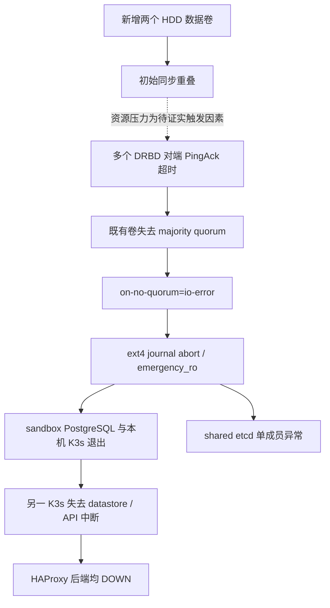

# 2026-09-25 DRBD quorum 抖动与 sandbox 控制面中断

状态：服务已恢复；事故机制已确认，资源争用的具体瓶颈与预防性整改仍待验证。
时间统一使用 UTC。报告依据当日 PVE/VyOS/guest 现场日志、相关操作会话和未提交 IaC；
不是全量数据完整性审计，也不把短期恢复等同于根因消除。

## 结论

共享 PostgreSQL 的承载准备在 17:12 为 CT150、CT151 新建 16 GiB、32 GiB HDD DRBD
数据卷，两卷初始同步重叠。随后多个既有 DRBD 资源出现 PingAck 超时和 quorum 丢失。
sandbox1 根卷在 17:15:49 因 I/O 错误中止 ext4 journal、进入只读，PostgreSQL 主库和
本机 K3s 退出；sandbox2 K3s 也失去数据库连接。VyOS HAProxy 摘除了不可连接的后端，
从客户端看起来像 LB 故障。etcd CT150 的 SSD 根卷在 17:16:52 也发生同类故障。

**已确认的直接故障机制**是 DRBD 失去 quorum 后按 `on-no-quorum=io-error` 返回错误，
引发 ext4 只读和上层服务中断。**最有证据支持的触发因素**是新 HDD 卷并发初始同步期间的
共享资源压力；尚无故障时段的链路队列、丢包、磁盘延迟和 CPU 调度证据，不能定论为
某条链路打满、某块磁盘损坏或唯一由 resync 流量造成。

这次更接近故障的操作是“创建数据卷并触发复制”，不是 15:30–15:32 已完成的 etcd
rootfs 迁移。新 shared PostgreSQL 当时尚未启动，未迁移现有 CNPG 或 sandbox 数据库；
影响经共享底层存储扩散到原有服务。

## 影响与恢复边界

| 对象 | 已观察到的影响 | 恢复证据 |
| --- | --- | --- |
| sandbox PostgreSQL，`10.60.0.1:5432` | 主库 `10.60.0.11` 停止监听，LB 无可用 backend | 原主库 crash recovery 完成；sandbox2 streaming/sync，采样 replay lag=0 |
| sandbox K3s，`10.60.0.13:6443` | 两个 API 后端拒绝连接，控制面不可用 | 两个直连 API 与 VIP `/readyz=ok`；两节点和全部 Pod Ready |
| OpenSandbox，`10.60.0.13:8080` | 健康入口仍可返回 200；依赖 K3s 的生命周期操作受控制面中断影响 | `/health` healthy；本轮未实际创建/销毁 sandbox，不能用 health 替代业务验收 |
| shared etcd CT150 | SSD rootfs `emergency_ro`，成员无法正常服务，触发无 leader/频繁选举告警 | 另一会话完成离线修复，记录三成员 endpoint healthy、Raft term/index 一致 |
| 其他 DRBD 资源 | pve1 在限定窗口记录 11 个资源共 43 次 quorum 丢失 | 尚未逐项完成 guest/应用层影响审计，不能说其他服务均未受影响 |

API 全后端不可用从 HAProxy 17:16:01 告警可确认；约 17:49 已有可用 API，
约 17:51 完成双后端、节点与 Pod 验收。控制面中断约 33 分钟，完整恢复约 35 分钟。
恢复后的复制和服务检查未发现新的异常，但不能据此证明中断期间全部业务请求成功或零数据丢失。
数据库日志曾记录同步等待取消及“本地已提交、可能尚未复制”，未逐事务审计；未执行 WAL reset、
standby 提升、数据库重建或恢复旧备份。

## 变更范围与存储映射

| 用途 | PVE/容器 | DRBD resource | 设备 | 存储池/大小 |
| --- | --- | --- | --- | --- |
| 既有 sandbox1 根盘，包含 K3s datastore 主库 | pve1 / CT148 | `pm-6d8bee62` | `drbd1007` | `pve-rg-hdd` / 32 GiB |
| etcd-pve1 根盘 | pve1 / CT150 | `pm-d1d1f3ea` | `drbd1008` | `pve-rg` SSD / 8 GiB |
| 新 PG standby 数据盘 | pve1 / CT150 mp0 | `pm-af21c43d` | `drbd1011` | `pve-rg-hdd` / 16 GiB |
| 新 pgBackRest 仓库盘 | pve2 / CT151 mp0 | `pm-de86804d` | `drbd1012` | `pve-rg-hdd` / 32 GiB |

17:12:20，pve1 作为 SyncSource 向 pve3 同步 CT150 新盘；17:12:56，pve1 又作为
SyncTarget 从 pve2 接收 CT151 新盘。容器操作串行不代表底层复制串行，也不代表不同
SSD/HDD 池具有独立的网络、宿主调度或 I/O 故障域。

## 时间线

| UTC | 事件与证据 |
| --- | --- |
| 15:30:16–15:31:09 | CT150 `move_volume` 完成，PVE 任务 OK；`local-lvm` → `pve-rg` |
| 15:31:32–15:32:11 | CT151 同类迁移完成；会话随后确认三 etcd 端点健康 |
| 17:09:14 | PG 会话说明即将创建独立 HDD mp0、增加内存预算，不启动 PG |
| 17:11:46 | 执行 `ansible-playbook pve-storage.yml` |
| 17:12:20 / 17:12:56 | 两个新 HDD 资源分别开始 DRBD 初始同步，发生重叠 |
| 17:14:00 | 本报告 17:10–17:55 pve1 内核窗口内首条 `quorum( yes -> no )`；对象为既有 `pm-59a94edd` |
| 17:14:09 | PG 会话报告承载准备完成、etcd 健康；未包含 DRBD 同步完成和跨服务检查 |
| 17:15:47–17:15:48 | sandbox1 根卷先后丢失 pve3、pve2 连接，quorum yes→no |
| 17:15:49 | `drbd1007` 写入错误、MMP 写失败、journal abort、只读；PG 启动控制命令报 I/O error，K3s SIGBUS |
| 17:15:54 | HAProxy 报 sandbox1 API 和 PostgreSQL 后端 DOWN |
| 17:16:01 | sandbox2 API 后端也 DOWN，K3s backend 无可用服务器 |
| 17:16:52 | CT150 `drbd1008` 失去 quorum，ext4 进入只读 |
| 17:18:53 | PG 会话发现 CT150 只读，暂停后续部署；另两个 etcd 成员健康 |
| 17:20:27 | 维护者在 PG 会话提供 `SharedEtcdNoLeader` 实际通知 |
| 17:20–17:25 | 准备限速；先遇到 playbook 路径错误，随后遇到 YAML 条件表达式类型错误，修正后重跑 |
| 17:23:39 | 该内核窗口内最后一条 quorum 丢失；之后仍有 PingAck 超时，不能写成“限速后才停止 quorum 丢失” |
| 17:24:37 | Alertmanager 会话获知 etcd 正在另一路调整，结束该会话对 etcd 的排查 |
| 17:25:58 | 会话收到限速成功结果，两主机各 changed=1；新卷 `c-max-rate=10240` |
| 17:25:59–17:28:11 | CT150 停机、离线修复、重新启动；约 17:30 报告三成员健康 |
| 17:31:21 / 17:33:38 | CT151 / CT150 新数据卷分别完成 DRBD 同步，内核标记 resync-finished |
| 17:42 起 | 维护者报告 sandbox LB 异常，本会话开始排查 |
| 17:43–17:46 | 确认 HAProxy 正常、后端故障；定位 sandbox1 根盘 emergency_ro 和原始 quorum/I/O 日志 |
| 17:46:41–17:46:49 | CT148 正常关机完成 |
| 17:47–17:48 | `pct fsck 148 --device rootfs --force 1` 恢复 journal、清理 orphan inode；只读 `e2fsck -fn` 五阶段通过、返回 0 |
| 17:48:40–17:48:44 | CT148 启动；根盘恢复 rw 且无 emergency_ro |
| 17:49:04 / 17:49:08 | 原 PG 主库恢复接收连接；sandbox2 恢复同步 standby |
| 17:50:40 左右 | sandbox2 K3s 在重启服务后恢复 API；此前旧进程卡在故障期间的启动/关闭状态 |
| 约 17:51 | 两个 API 和 VIP readyz 通过、两节点及全部 Pod Ready、复制 lag=0 |
| 17:53:49 | 两个新卷现场复核均 Established/UpToDate，限速属性和运行配置仍为 10240 |

宿主默认 journal 展示曾为 UTC+9，guest/VyOS 使用 UTC。初次用 UTC 字面时间过滤宿主
本地日志没有找到错误；后来用 `journalctl --utc` 和明确 UTC 时间窗口纠正。上表不使用
未经转换的 `Sep 26 02:xx` 作为独立事故时间。

## 故障机制与变更保护缺口



1. **变更验收停在容器/etcd 层。** `serial: 1` 和 endpoint health 只限制 Ansible 的
   容器操作顺序；未等待前一 DRBD 新卷完全同步，所以后台复制仍重叠。
2. **未把新卷创建视为共享基础设施变更。** 新数据库尚未运行、卷内没有业务数据，
   仍会发生全卷复制并影响现有资源。仅检查新服务健康不能限制影响范围。
3. **恢复检查范围过窄。** 首轮识别并恢复 CT150 后，未沿同批 quorum/I/O 日志
   核查 CT148 等既有消费者；sandbox 控制面继续故障，直至维护者再次报告。
4. **监控缺少依赖链覆盖。** Alertmanager 通知当天已打通，etcd 实际告警送达；
   不能归因于“没有通知”。另一会话的盘点发现告警主要覆盖监控自身及 shared etcd，
   尚缺可证明有效的跨资源 DRBD、文件系统异常、sandbox API 外部可用性覆盖。
   `/health=200` 与单节点 Ready 也不足以证明两个 API 后端健康。
5. **紧急缓解执行有延迟。** 限速 playbook 首次工作目录错误、随后条件被 YAML
   解析成非字符串，两次均在配置变更前失败；直到 17:25:58 才有成功回执。

限速后短期稳定且最终同步完成支持资源压力假设，但缺少控制变量；本次最后一次 quorum
丢失早于成功限速，不能把时间相关性写成严格因果证明。现有 `pve-storage.yml` 已补入
限速任务，但位于 `pct set --mp0` **之后**；初始同步在创建卷时已经开始，仍存在未限速
窗口，并且仍缺 DRBD 同步完成屏障。此报告没有擅自更改这些并行工作中的实现。

## 已完成处置与验收

- PG/etcd 会话：仅为两个新卷设置资源级 `DrbdOptions/PeerDevice/c-max-rate=10240`
  （配置的自适应同步上限 10 MiB/s），记录幂等复跑无变更；CT150 离线修复后恢复三端点健康。
- 本会话：确认 CT148 stopped、卷身份/未挂载、副本 UpToDate/quorum 后，使用 PVE 安全自动
  fsck；返回 1 表示已修复，随后独立只读完整检查返回 0，再启动原容器。
- PostgreSQL 自行回放 WAL 并恢复原角色；未切主。sandbox2 K3s 在数据库恢复后仍卡住，
  仅重启该 K3s 服务，未重启或提升它的 PostgreSQL。
- 两个直连 API 与 VyOS VIP `/readyz` 均为 ok；全部 Pod Ready；所有相关 HAProxy
  后端 UP/L4OK；OpenSandbox `/health` healthy；目标根卷恢复正常 rw。
- 未修改 VyOS LB、全局 DRBD 协议/quorum/超时或集群网络。VyOS 最新提交及生成配置仍为
  9 月 18 日，最近两次 LB 变更仅新增 OpenSandbox 入口并调整其超时。

## 后续整改与关闭标准

下列项目是待办，不代表已获执行或发布授权；责任人/issue 由维护者分配。

| 优先级 | 项目 | 验收条件 |
| --- | --- | --- |
| P0 | 审计同批受影响 DRBD 资源对应 guest/应用 | 11 个资源逐一映射并记录文件系统、服务和数据层状态，不能只看 DRBD UpToDate |
| P0 | 新卷创建前实施同步预算，新增 DRBD 同步屏障 | 第一字节同步前限额已生效；全部所需副本 UpToDate/Established 才允许下一卷；超时/异常停止推进 |
| P0 | 扩大存储变更前后健康检查 | 验证已有 sandbox API、datastore、etcd 等消费者；新增 quorum loss、I/O 错误或只读即中止变更 |
| P1 | 采集并定位实际瓶颈 | 对齐三宿主网络丢包/队列、吞吐、磁盘 await、CPU/PSI、DRBD 状态；无证据不直接扩大 ping timeout |
| P1 | 补齐可操作告警 | DRBD quorum/peer、ext4 emergency_ro、数据库与 API 外部探测、LB 零后端，并演练真实通知链路 |
| P1 | 恢复后业务验收与数据检查 | 对现有 sandbox 生命周期操作做受控验收，核对 PG 数据/备份和应用影响，单独报告不能验证的 RPO |
| P1 | 复核共享故障域与同步总预算 | 同时覆盖多个 resource/peer；区分 SSD/HDD 池和物理网络/宿主故障域；设计限速或隔离方案后再测试 |
| P2 | 标准化取证与并行变更交接 | 时间统一 UTC；事故期间共享受影响资源表、执行日志和完成边界；先 syntax/check，再执行缓解 playbook |

关闭本次根因整改需完成：跨资源影响审计、同步前预算与屏障验证、消费者健康保护、
足够覆盖复制全过程的稳定性观察。当前只可宣称 **sandbox 服务恢复**。

## 证据与来源

### 现场关键摘录

```text
17:12:20 drbd pm-af21c43d/0 drbd1011 pve3: Began resync as SyncSource
17:12:56 drbd pm-de86804d/0 drbd1012 pve2: Began resync as SyncTarget
17:15:47 drbd pm-6d8bee62 pve3: PingAck did not arrive in time.
17:15:48 drbd pm-6d8bee62 pve2: PingAck did not arrive in time.
17:15:48 drbd pm-6d8bee62/0 drbd1007: quorum( yes -> no )
17:15:49 EXT4-fs error (device drbd1007): kmmpd:181: Error writing to MMP block
17:15:49 Aborting journal on device drbd1007-8.
17:15:49 EXT4-fs (drbd1007): Remounting filesystem read-only
17:16:52 drbd pm-d1d1f3ea/0 drbd1008: quorum( yes -> no )
17:16:52 EXT4-fs (drbd1008): Remounting filesystem read-only
17:31:21 drbd pm-de86804d/0 drbd1012 pve2: repl( SyncTarget -> Established ) [resync-finished]
17:33:38 drbd pm-af21c43d/0 drbd1011 pve3: pdsk( Inconsistent -> UpToDate ) repl( SyncSource -> Established ) [resync-finished]
```

上述为 pve1 内核摘录，已省略重复前缀。43 次 quorum 丢失统计范围为 pve1 的
`2026-09-25 17:10:00 UTC` 至 `17:55:00 UTC`，不是三节点全集群事件数。
资源为 `pm-1f83b001`、`pm-57eb0cd7`、`pm-59a94edd`、`pm-6d8bee62`、
`pm-7ad1a714`、`pm-a58b5f08`、`pm-cbba8c9d`、`pm-d1d1f3ea`、
`pm-d4c12a89`、`pm-f21d1da3`、`vm-101-cloudinit`。

可复核入口：宿主 `journalctl --utc -k --since '2026-09-25 17:10:00 UTC'
--until '2026-09-25 17:55:00 UTC'`、`pvenode task list`、目标 `drbdsetup status`；
VyOS `journalctl -u haproxy` 和只读 stats socket；guest PostgreSQL/K3s journal。
日志有保留期限，后续审计应保存经过秘密审查的所需片段。

### 操作会话

按维护者指向的 spaces1、spaces3 线索，读取了本地以下实际会话；以会话 ID/标题定位，
不把 UI 的位置编号当作长期标识。不复制完整会话或凭据。

- `01a0d8c1-c4ad-7360-b52e-2a11c34dc13e`，**规划共享 PostgreSQL 数据库**：
  17:11:46 工具调用 `ansible-playbook pve-storage.yml`；17:20:27 输出显示默认
  `c-max-rate=102400k`，这只是配置上限，不是已测吞吐；17:25:58 两卷限速成功；
  17:30–17:31 报告 CT150 恢复；对应 rollout 的关键记录在行 1916、2019、2068 附近。
- `01a0d972-e6e5-7432-ad4b-4fd7ca7b3956`，**配置 Alertmanager 通知**：
  17:13 用户确认测试通知送达；17:20 后观察到 etcd 新故障；17:24:37 用户确认
  另一路正在调整 etcd；约 17:28–17:30 记录监控覆盖缺口。该会话的监控盘点不等于
  对 sandbox 集群做过完整事故验收。
- `01a0d9a9-7ef0-7992-a313-54668bb3b4e4`，**检查 VyOS 上的 LB 配置**：
  本次 sandbox 诊断、CT148 离线恢复和最终链路验收。

本地原记录位于 `/home/panxiao81/.codex/sessions/2026/09/25/`。
会话说明只能证明当时的判断；时间线中执行结果以工具回执、PVE 任务和内核日志交叉核对。

### 相关源码与运行手册

- etcd rootfs 迁移：`infrastructure/etcd/ansible/move-storage.yml`
- PG 数据卷准备：`infrastructure/shared-postgresql/ansible/pve-storage.yml`
- 新卷限速任务：`infrastructure/shared-postgresql/ansible/tasks/limit-resync.yml`
- etcd 故障恢复记录：`infrastructure/etcd/README.md`
- shared PostgreSQL 当前部署边界：`infrastructure/shared-postgresql/README.md`
- sandbox 架构与数据库依赖：`infrastructure/sandbox-cluster/README.md`

上述源码路径相对于 homelab-infra；etcd/shared-postgresql 文件在取证时仍未提交，
当前文件已包含事故后的限速补丁，不能倒推事故前已经有同样保护。
本报告以 wiki 为唯一维护位置，长期操作流程见[Proxmox 恢复手册](../services/proxmox.md#sandbox-lb-与根文件系统恢复)。
源码合并后再补其固定版本链接。

### 取证过程中的敏感输出问题

首次 VyOS 查询误认为 `cli-shell-api showConfig` 尾随 `load-balancing` 会限制子树，
实际返回完整配置，包含 WireGuard 私钥及登录密码哈希，进入了本会话工具输出。
后续已改为设备端提取所需段，并在 `CLAUDE.md` 记录陷阱；未把敏感值写入报告或仓库。
既有会话记录并未因此消除，应限制其分享；相关凭据轮换需另行安排，不能称为已处理完毕。
